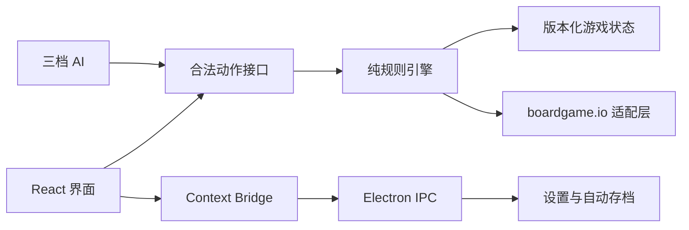

<div align="center">
  
  <h1>璀璨宝石</h1>
  <p>面向 Windows 的离线单人人机策略桌游</p>
</div>

## 项目简介

《璀璨宝石》是一款使用 Electron、React 和 TypeScript 制作的 Windows 离线桌游。玩家通过收集宝石筹码、购买发展卡、建立永久折扣并接待贵族，与 1-3 名 AI 对手争夺最高威望。

项目实现经典基础版的核心内容，包括 90 张发展卡、10 位贵族、2-4 人资源配置、黄金替代、保留牌、10 枚筹码上限、贵族选择、15 分终局和同分判定。

本项目仅供个人学习和离线娱乐。视觉、图标、宝石、卡面、贵族徽章、桌面纹理和程序化音效均为项目原创内容，不包含实体游戏扫描素材。

## 主要特性

- 完整的 2-4 人经典基础版规则
- 1 名人类玩家对战 1-3 名 AI
- 简单、普通、困难三档 AI，每个席位可独立设置
- 困难 AI 使用隐藏信息确定化和受限搜索
- 90 张发展卡，按一、二、三阶分别为 40、30、20 张
- 10 位贵族，每局使用“玩家人数 + 1”位
- 支持市场购牌、公开保留和牌库暗抽
- 自动计算永久折扣、彩色筹码支付与黄金替代
- 自动补牌、筹码超限归还和多贵族选择
- 每次有效行动后自动保存，可从主菜单继续游戏
- 损坏或版本不兼容的存档会被安全忽略并提示
- AI 行动支持 `1x`、`2x` 和“立即”三档播放速度
- 背景氛围和操作音效可分别调整
- 支持全屏、减少动态效果和完整键盘焦点导航
- 完全离线，不包含账号、遥测、更新器或网络请求
- Windows x64 免安装便携版

## 下载与运行

推荐从仓库的 **Releases** 页面下载：

`璀璨宝石-Portable-x64.exe`

下载后直接双击运行，无需安装。便携版会在启动时将运行资源解压到临时目录，首次看到窗口前可能需要等待约 20-30 秒。

程序目前没有商业代码签名证书，Windows SmartScreen 可能显示“未知发布者”。确认文件来自本仓库 Release 后，可选择“更多信息”继续运行。

### 系统要求

- Windows 10 或 Windows 11
- x64 处理器
- 建议分辨率 `1463 x 914` 或更高
- 最低窗口尺寸 `1280 x 720`
- 不需要网络连接

## 游戏目标

购买发展卡和接待贵族可以获得威望。当任意玩家在自己的回合结束时达到至少 15 点威望，游戏会补齐当前轮次，然后进行结算：

1. 威望最高者获胜。
2. 威望相同时，购买发展卡更少者获胜。
3. 若仍完全相同，则共同获胜。

保留但尚未购买的发展卡不计入终局卡牌数量。

完整操作与规则请阅读 [游戏说明书](游戏说明书.md)。

## 回合规则速览

每个回合选择一项主要行动：

### 拿取三种宝石

从供应区拿取 3 枚不同颜色的彩色筹码。若供应区不足三种颜色，则分别拿取所有仍有库存的颜色。

### 拿取两枚同色宝石

选择一种彩色宝石并拿取 2 枚。执行前，该颜色在供应区必须至少有 4 枚。

### 购买发展卡

购买市场牌或自己的保留牌。永久折扣先降低对应颜色成本，彩色筹码不足的部分由黄金自动补足。

### 保留发展卡

保留一张市场公开牌，或从任意阶级牌库暗抽一张。每位玩家最多保留 3 张牌；供应区有黄金时会同时获得 1 枚。

主要行动结束后依次处理：

1. 若筹码超过 10 枚，归还至 10 枚，黄金也计入上限。
2. 检查永久折扣是否满足贵族要求，每回合最多接待一位贵族。
3. 检查是否达到 15 点并触发终局。
4. 自动保存并进入下一位玩家的回合。

## AI 设计

### 简单

从合法行动中随机选择，并对立即可购买的发展卡给予基础偏好，适合第一次接触规则的玩家。

### 普通

基于启发式评分评估行动，综合考虑：

- 发展卡威望与阶级
- 支付成本和购牌效率
- 永久折扣价值
- 目标卡牌的颜色需求
- 贵族完成进度
- 对关键市场牌的保留价值

### 困难

在普通评估基础上，对牌库和其他玩家的隐藏保留牌进行确定化采样，并使用受限的 UCB 搜索与短程 rollout 比较候选行动。搜索只使用公开信息和 AI 自己的隐藏信息。

## 数据配置

| 玩家总数 | 每种彩色筹码 | 黄金 | 贵族 |
| ---: | ---: | ---: | ---: |
| 2 | 4 | 5 | 3 |
| 3 | 5 | 5 | 4 |
| 4 | 7 | 5 | 5 |

| 发展卡阶级 | 数量 |
| ---: | ---: |
| 一阶 | 40 |
| 二阶 | 30 |
| 三阶 | 20 |

## 技术栈

| 范围 | 技术 |
| --- | --- |
| 桌面运行时 | Electron 43 |
| 前端 | React 19、TypeScript 5 |
| 构建 | electron-vite、Vite 7、electron-builder |
| 游戏接口 | boardgame.io 适配层、确定性纯状态转换 |
| 数据校验 | Zod |
| 图标 | Lucide React |
| 字体 | Noto Sans SC、Noto Serif SC |
| 测试 | Vitest |

## 架构



核心规则不直接依赖界面。每个动作都通过 `applyMove` 进行校验并产生新的状态，UI 不会直接修改游戏状态。洗牌使用可保存的种子和随机数状态，因此存档恢复后可以继续同一局游戏。

## 项目结构

```text
.
|-- resources/                  # 应用图标
|-- scripts/
|   `-- generate-assets.mjs     # 原创图标与位图资源生成
|-- src/
|   |-- game/
|   |   |-- ai.ts               # 三档 AI 与确定化搜索
|   |   |-- boardgame.ts        # boardgame.io 游戏适配
|   |   |-- data.ts             # 发展卡、贵族与宝石元数据
|   |   |-- engine.ts           # 确定性规则引擎
|   |   |-- random.ts           # 可保存的种子随机数
|   |   |-- types.ts            # 核心类型
|   |   `-- validation.ts       # 存档结构校验
|   |-- main/                   # Electron 主进程
|   |-- preload/                # 隔离的桌面 API
|   |-- renderer/               # React 界面、样式、声音与视觉资源
|   `-- shared/                 # IPC 类型与常量
|-- tests/                      # 数据、规则、AI 与存档测试
|-- THIRD_PARTY_NOTICES.md      # 第三方说明
|-- 游戏说明书.md                # 完整中文说明书
`-- package.json
```

## 本地开发

### 环境要求

- Node.js 22.12 或更高版本
- npm 10 或更高版本
- Windows x64，用于生成和验收便携版 exe

### 安装依赖

```powershell
npm install
```

Electron 安装脚本需要下载对应版本的 Windows 运行时。如果安装过程被中断，可重新执行：

```powershell
npm rebuild electron
```

### 启动开发环境

```powershell
npm run dev
```

### 类型检查

```powershell
npm run typecheck
```

### 运行测试

```powershell
npm test
```

### 生产构建

```powershell
npm run build
```

### 生成 Windows 便携版

```powershell
npm run package
```

输出文件：

```text
release/璀璨宝石-Portable-x64.exe
```

如需未封装的目录版本：

```powershell
npm run package:dir
```

## 测试范围

当前测试覆盖：

- 三阶发展卡数量、ID、颜色、成本和威望合法性
- 10 位贵族的数据完整性
- 2-4 人筹码与贵族配置
- 种子洗牌的可复现性
- 三色拿取和同色双取
- 10 枚筹码上限与强制归还
- 公开保留、暗抽保留和黄金获取
- 购买、支付、永久折扣和市场补牌
- 单贵族自动到访与多贵族选择
- 15 分终局、补齐轮次和同分判定
- 简单、普通、困难 AI 的完整合法对局模拟
- 正常、损坏和未来版本存档结构校验

## 存档与设置

游戏数据保存在 Windows 用户数据目录，而不是便携版 exe 所在目录：

```text
%APPDATA%\brilliant-gems\save-v1.json
%APPDATA%\brilliant-gems\settings.json
```

每个有效行动提交后都会自动保存。关闭窗口或返回主菜单时，对局进度会保留。损坏或不兼容的存档不会阻止游戏启动。

## 安全与隐私

Electron 配置遵循最小权限原则：

- `contextIsolation: true`
- `nodeIntegration: false`
- 渲染器沙箱开启
- 严格内容安全策略
- preload 只暴露版本化的设置、存档和窗口控制 API
- 存档先经过结构化校验，再进行原子写入
- 不包含网络 API、账号、遥测、广告、自动更新器或远程内容

## 视觉与音频

界面采用深石墨桌面、象牙文字、黄铜高光和五种高饱和宝石色。发展卡使用原创切割面光效，贵族徽章、宝石图形、纹理和应用图标均由项目资源脚本生成。

声音使用本地程序化 Web Audio，不请求网络媒体。玩家可以分别调整背景氛围和操作音效，也可以开启“减少动态效果”。

## 已知限制

- 仅提供简体中文。
- 仅支持单人人机对战，不支持本地多人或在线联机。
- 不包含扩展包、成就、账号、云存档和自动更新。
- 便携版未签名，可能触发 Windows SmartScreen。
- 单文件版每次启动都需要解压运行资源，因此比安装版启动稍慢。

## 法律与素材说明

本项目是非官方、非商业的个人离线实现，与任何桌游发行商或商标持有人无隶属、授权或合作关系。

项目不使用官方标志、实体卡牌扫描图、贵族肖像、原版音频或其他官方美术素材。经典机械数值的交叉核对来源见 [THIRD_PARTY_NOTICES.md](THIRD_PARTY_NOTICES.md)。

仓库当前标记为 `UNLICENSED`。公开可见不代表授予复制、修改、再分发或商业使用许可。第三方依赖分别遵循其自身许可证。

## 版本

当前版本：`1.0.0`

Windows x64 便携版由 `electron-builder` 生成，Release 页面同时提供文件大小和 SHA-256 校验值。
